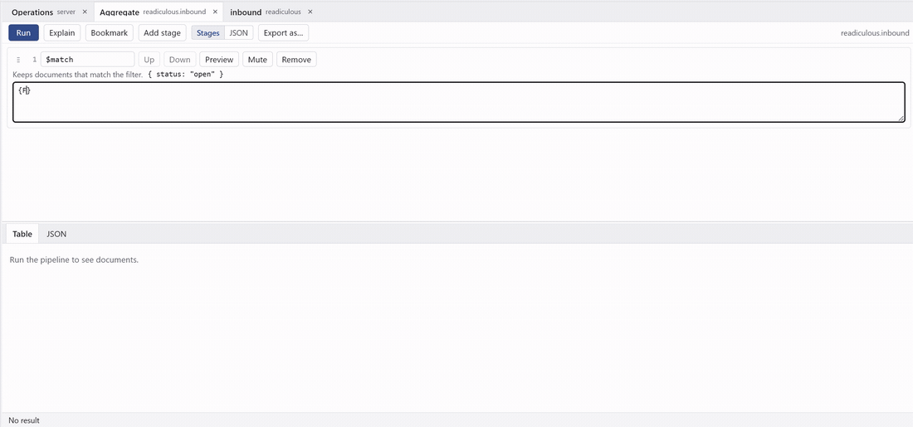
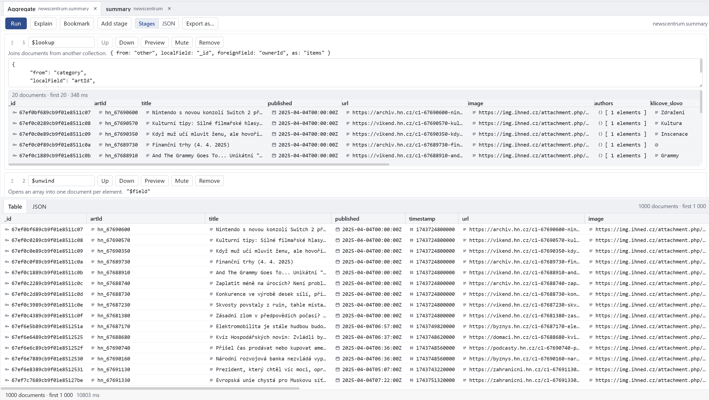
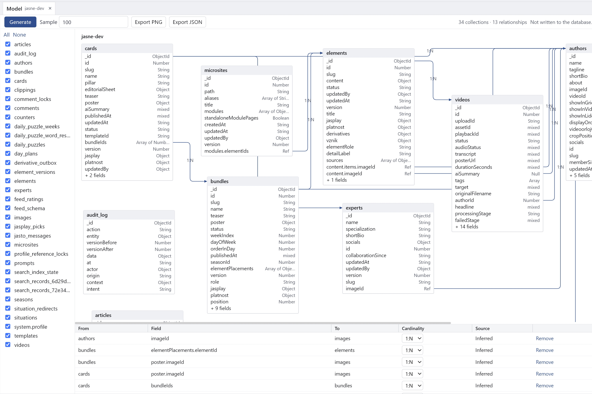
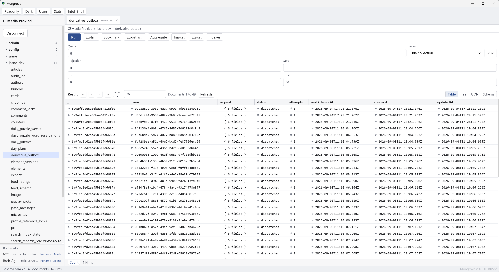
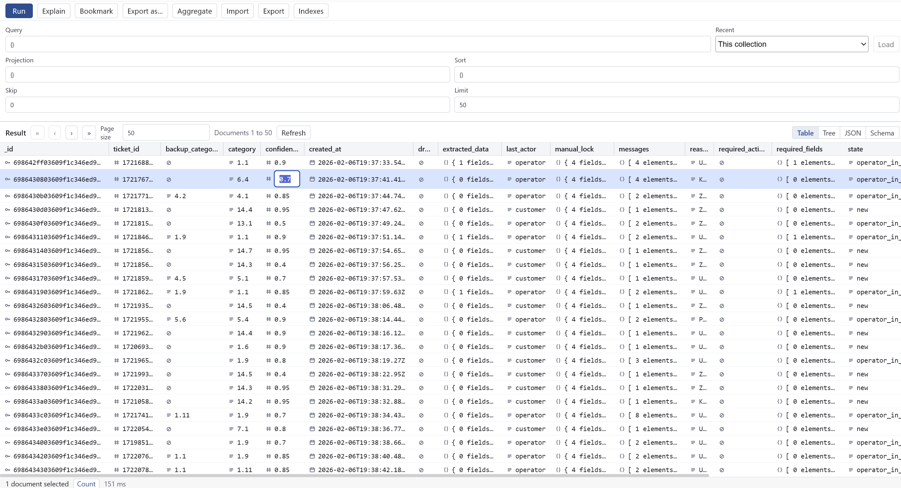
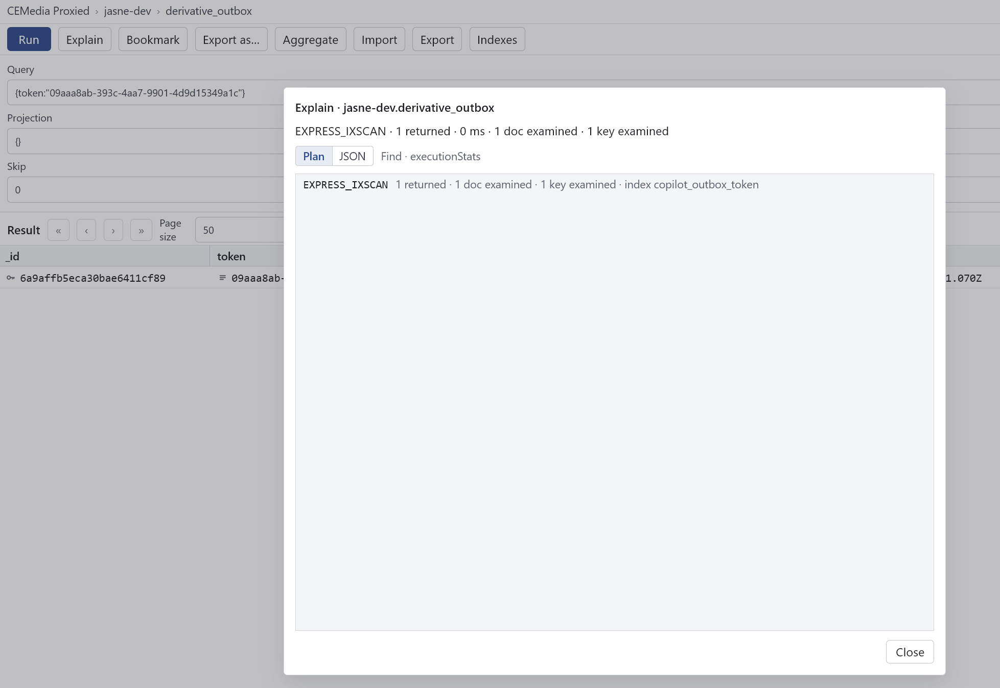
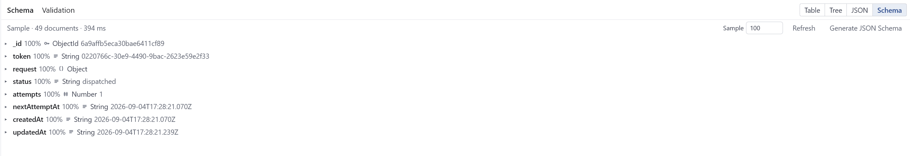
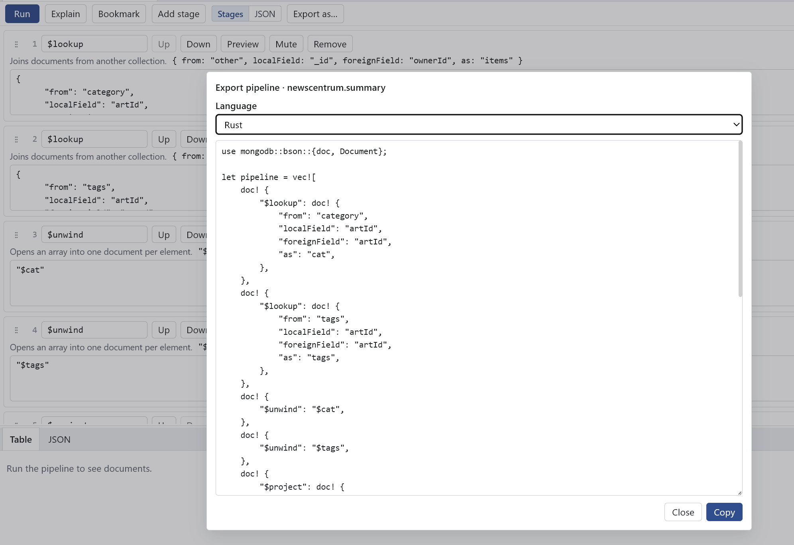

# Mongrove

**Lightweight desktop MongoDB client.** Dense UI. Visual Aggregate Builder.

**Website:** [maly.github.io/mongrove](https://maly.github.io/mongrove)

**Public alpha (v0.2.0).** Use at your own risk.  
Built for people who write aggregation pipelines every day and want something denser than Compass and lighter (and cheaper) than Studio 3T.

## Key features

- **Visual Aggregate Builder** — drag & drop stages, live preview of each stage, export the pipeline to code
- **Data Model / ERD** — generate an entity-relationship diagram from collections, with inferred relationships and export to PNG/JSON
- **Visual Explain** — see how your queries and pipelines actually run
- **Schema tab** — explore document shape without leaving the app
- **Readonly mode** — safe for production connections
- **Flexible data views** — table, JSON, and tree. Edit documents directly in the table

## Why Mongrove

| | Mongrove | Compass | Studio 3T |
|---|---|---|---|
| **Windows download** | **3.6 MB** | ~180 MB | ~370–420 MB |
| **macOS download** | **5.4 MB** | ~170 MB | large |
| **Linux download** | **6 MB** (.deb) | ~123 MB | — |
| **RAM (idle, Windows)** | **~47 MB** | 400+ MB | hundreds of MB |
| **Startup (Windows)** | **~1 s** | several seconds (typically 3–5 s) | similar or slower |

Mongrove is roughly 50× smaller than Compass on Windows and uses about 8–10× less RAM. It starts quickly and stays out of the way.

Numbers measured on Mongrove v0.1.0. Compass and Studio 3T figures are typical current values.

## Screenshots

### Aggregate Builder

Drag & drop stages, live preview of each stage, export the pipeline to code.





### Data Model / ERD

Generate a diagram of collections, fields, and relationships. Export as PNG or JSON. Changes stay visual — nothing is written to the database.



### Main window

Dense layout with connection tree and collection data.



### Table view

Documents as a table, with inline editing.



### Visual Explain



### Schema tab



### Export to language



## More

- [Features](FEATURES.md) — what’s already done
- [Roadmap](ROADMAP.md) — what’s next (moves fast)

## Download

[Latest releases](https://github.com/maly/mongrove/releases)

Windows, macOS, and Linux.

**macOS:** The build is not signed yet (working on Apple Developer ID).  
If macOS blocks it, run:

```bash
xattr -rd com.apple.quarantine /Applications/Mongrove.app
```

Then open it normally.

## Support

Mongrove is free. If it saves you time, you can support further development:

[Donate via Stripe](https://buy.stripe.com/4gM5kubSU3ibaXH5nX7AI07)

No features are unlocked — this is voluntary support for the developer.

## Public alpha

This is a public alpha. Things may break, change, or lose data.  
**Use at your own risk.** Do not point it at production data you cannot afford to lose.

Feedback is especially useful on:

- how the Aggregate Builder feels compared to what you use now
- UI density (too sparse? too cramped?)
- anything that blocks daily use

**Discussions:** [GitHub Discussions](https://github.com/maly/mongrove/discussions)  
**Issues:** [GitHub Issues](https://github.com/maly/mongrove/issues)

## About

Donationware. The core stays free forever. Donations are voluntary support for continued development.

Stack: Tauri 2 + Svelte 5 + MongoDB Rust driver. Credentials stored in the OS keychain. SOCKS5 proxy supported.
